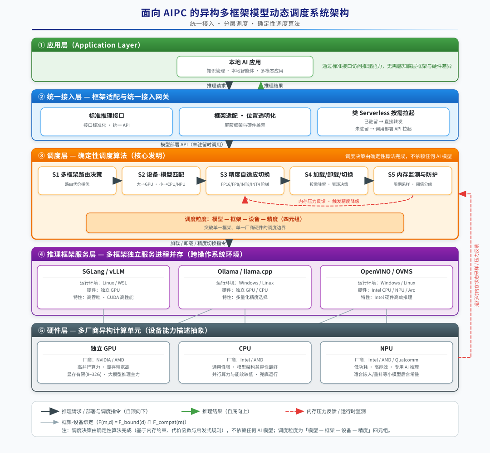
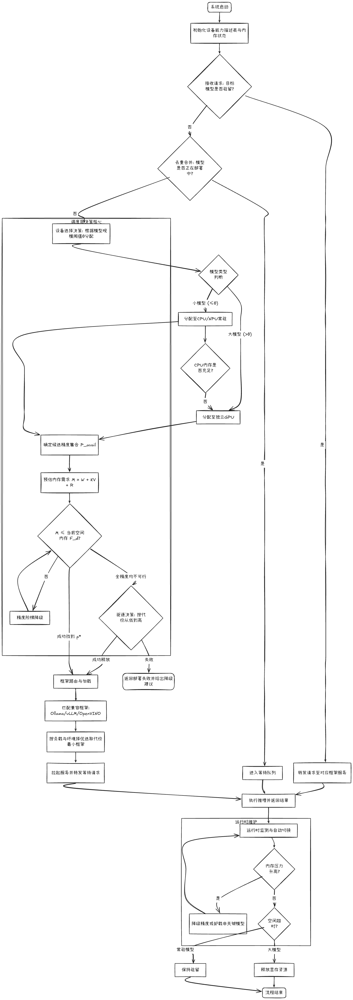

#  一种面向AIPC的异构多框架模型动态调度方法与系统                                                                                   
---

## 1 背景（Background）

### 1.1 要解决的技术问题

**本地AI应用需要多种模型协同，而本地异构资源有限。** 以面向AIPC的个人知识管理应用或者本地智能体应用为代表，本地AI应用的核心功能往往依赖多种异构AI模型协同工作，包括大语言模型、多模态模型、嵌入模型、重排模型、文档解析模型等。这些模型参数量、内存占用、计算特性各异，而AIPC本地的计算资源是异构且有限的，通常由CPU、独立GPU、NPU等异构计算单元组成。这些部件可能来自不同厂商（如Intel、AMD、NVIDIA、Qualcomm等），构成多种多样的异构硬件组合，其中以Nvidia GPU为例，其发布的桌面级显卡显存规格通常为8G/12G/24G/32G规格范围，且不支持扩容，全部模型无法同时驻留显存，必须按需加载、卸载与切换。

三类异构计算单元的特性差异显著：CPU具有最强的通用性与模型架构兼容性，可运行任意架构的模型，但并行算力与能效最低；独立GPU（以NVIDIA为例）具有最高的并行算力与显存带宽，是大参数模型推理的主力，但显存容量有限（8G/12G/24G/32G规格范围）且不支持扩容；NPU是专为AI推理设计的专用计算单元，其核心优势在于低功耗、高能效——以Intel酷睿Ultra处理器为例，NPU专为持续性AI负载设计，能以远低于CPU/独立GPU的功耗长时间运行推理任务，避免独占CPU造成系统卡顿、避免唤醒高功耗的独立GPU，特别适合嵌入、重排等小模型在后台常驻运行，但NPU算力有限且通常仅支持有限的精度（如INT4）与有限的模型架构。三类单元在算力、内存、功耗、精度支持上的差异化，正是本发明进行异构设备-模型匹配分配的依据。

**没有任何单一推理框架能同时覆盖全部模型架构与全部硬件。** 当前主流推理框架各有边界：有的框架仅支持有限的模型架构，有的框架仅支持特定操作系统，有的框架仅支持特定厂商的硬件。因此要在同一台AIPC上运行全部所需模型，客观上需要多个推理框架并存，分别运行在不同的操作系统环境与不同的硬件设备上。
- Sglang/Vllm: Linux系统支持最好；Windows存在一些兼容性问题，且新特性支持较慢，比如不支持Nvidia 50系显卡的FP8精度和NVFP4精度的推理，在cuda生态下拥有最好的性能。
- Ollama/llama.cpp：支持Linux和Windows系统，支持较多的量化精度选择，但主要面向单模型单机服务，缺乏多模型统一服务与调度能力，对嵌入/重排/文档解析等非生成类模型支持有限
- OpenVINO/OVMS: 支持Linux和Windows系统，支持Intel CPU、NPU、Arc GPU的高效推理，但不支持其它厂商的独立GPU
- ONNX Runtime / DirectML：支持Windows系统，微软推出的跨设备推理运行时，可借助DirectX在Windows上覆盖NVIDIA/AMD/Intel等多厂商GPU与NPU，但模型需预先转换为ONNX格式，新架构与低比特量化（FP8/NVFP4等）支持较弱，整体比较平庸。

**核心技术问题**：在AIPC有限的异构计算资源（CPU/NPU/独立GPU）约束下，如何对运行在多个推理框架、多个操作系统环境、多种硬件设备上的多种AI模型进行统一的动态调度——包括跨框架的统一接入、模型的自动加载/卸载/切换、量化精度的自动选择，以及设备与模型的匹配分配——从而在异构多框架环境中保证端到端性能与用户体验。

### 1.2 现有技术方案及其不足

**现有方案一（最接近的现有技术）：单一厂商生态的统一调度，以Intel xpu生态通过OpenVINO统一调度为代表。** 该方案在Intel硬件体系内提供统一的模型推理调度能力。其不足在于：

(1) **硬件覆盖受限**——OpenVINO仅支持Intel自有硬件（Intel CPU/Intel NPU/Intel Arc GPU），不支持NVIDIA、AMD等厂商的独立GPU；

(2) **不支持多模型的自动切换**——缺乏面向多模型场景的自动加载/卸载/切换机制，无法在内存受限条件下让多种模型按需动态驻留；

(3) **不支持量化精度的自动切换**——无法根据当前内存压力在FP16/FP8/INT8/NVFP4/INT4等精度间自动降级或升级；

(4) **对新架构模型支持较慢**——模型需经过官方转换/注册后方可在OpenVINO上运行，对新发布模型架构的适配依赖官方版本的更新节奏，且NPU等设备的低比特量化模型同样依赖官方适配和发布，新架构模型（如新发布的Vision-Language类、专用文档解析类模型）往往需要等待数个版本周期才能使用。

本发明与该最接近现有技术的对比如下：

| 对比维度     | 本发明（多框架适配调度）                                            | OpenVINO统一调度                          |
| ------------ | --------------------------------------------------------------------- | ------------------------------------------- |
| 硬件覆盖     | 支持NVIDIA/AMD独立GPU与Intel/AMD CPU/NPU等多厂商异构硬件            | 仅支持Intel自有硬件          |
| 框架覆盖     | 统一适配多个异构推理框架                                              | 单一框架                                    |
| 模型自动切换 | 支持多模型自动加载/卸载/切换                                          | 不支持                                      |
| 精度自动切换 | 支持按内存压力自动降级/升级量化精度                                   | 不支持                                      |

**现有方案二：静态部署方案。** 预先选定固定数量的模型常驻内存，或为每个模型手工指定固定的框架与设备。其不足在于：无法覆盖全部场景需求；静态驻留的大模型挤占其他模型的内存；缺乏动态调度能力，资源利用率低。

**现有方案三：简单的模型按需加载/卸载（LRU/LFU策略）。** 需要时加载，用后按LRU/LFU驱逐。其不足在于：未考虑异构硬件（CPU/NPU/GPU）的差异化特性；未考虑模型重加载代价差异；未涉及跨框架的统一适配与精度切换。

**综上**，现有方案均以"单一框架 + 单一厂商硬件"为前提，无法解决"AIPC异构多框架环境下，多模型跨框架、跨硬件、跨精度的统一动态调度"这一核心问题。

---

## 2 发明要点及技术优势（Summary of Invention）

### 2.1 核心发明要点

本发明提出一种**面向AIPC的异构多框架模型动态调度方法与系统**，以"多框架适配调度方法"为核心，辅以紧密相关的三项支撑要点：

**要点一（核心）：多框架适配的统一调度方法。** 建立框架适配层，将分别运行于不同操作系统环境、不同硬件设备上的多个异构推理框架统一封装为标准推理接口，屏蔽框架与硬件差异。所覆盖的异构计算单元包括独立GPU、CPU、NPU等，且不绑定具体硬件厂商（如NVIDIA、Intel、AMD、Qualcomm等）。在此之上由调度器对多种模型进行统一的动态调度，实现跨框架的模型自动切换与量化精度自动切换，突破单一框架、单一厂商硬件的调度边界。

**要点二：异构设备-模型匹配分配。** 针对CPU/NPU/GPU三类异构计算单元，根据模型规模、推理速度差异和内存约束进行差异化分配：大参数模型分配至独立GPU，小参数模型常驻CPU/NPU，使每个模型运行在与其特性匹配的设备上，最大化异构资源利用率。

**要点三：量化精度自适应切换。** 在内存压力变化时，按设备与场景在FP16/FP8/INT8/NVFP4/INT4等精度间自动降级或升级，将精度损失控制在用户可接受范围内，在不驱逐模型的前提下释放内存。

需要说明的是，上述调度决策均由确定性算法完成，不依赖任何AI模型参与，从而保证调度的确定性、可解释性与极低开销。

### 2.2 技术优势

相较于现有方案（尤其是OpenVINO单一厂商生态统一调度），本发明具有以下优势：

(1) **跨硬件、跨框架统一调度**：突破OpenVINO仅支持Intel硬件、单一框架的限制，同时调度独立GPU（NVIDIA/AMD等）与CPU/NPU（Intel/AMD等）等多厂商异构硬件，统一适配多个异构推理框架，使每个模型运行在最适配的框架与硬件上。

(2) **模型自动切换**：在内存受限条件下实现多模型的自动加载/卸载/切换，这是OpenVINO所不具备的能力。

(3) **精度自动切换**：根据内存压力自动选择量化精度，在不牺牲可用性的前提下压缩内存占用，这是OpenVINO所不具备的能力。

(5) **异构资源利用率最优化**：在有限独立GPU显存约束下，小模型常驻CPU/NPU不占GPU显存，大模型动态加载至GPU并自适应选择精度，实现全栈多模型协同而不触发内存溢出。

(5) **跨厂商异构硬件的可推广性**：调度机制以统一的设备能力描述抽象异构硬件，与具体硬件厂商正交，可推广至Intel、AMD、Qualcomm等多种异构硬件组合。

---

## 3 实施方案描述（Description）

### 3.1 系统整体架构

本发明采用"统一接入、分层调度"的设计，自上而下分为应用层、统一接入层、调度层、推理框架服务层和硬件层五个层次。



**各层职责说明：**

- **应用层**：本地AI应用（如知识管理应用），通过统一接入层访问模型推理能力，无需感知底层框架与硬件差异。
- **统一接入层**：框架适配与统一接入网关，将多个异构推理框架封装为标准推理接口，实现接口标准化与框架/位置透明化。该层采用类Serverless的按需拉起机制：模型默认不常驻，当请求到达时网关先判断目标模型服务是否已驻留——已驻留则直接转发，未驻留则调用调度层的模型部署API按"设备-精度-框架"决策拉起模型服务，待服务就绪后再转发请求，从而实现模型的按需动态驻留。
- **调度层**：本发明的核心，由确定性调度算法实现多框架路由决策、设备-模型匹配分配、精度自适应切换、模型加载/卸载/切换管理与内存监测防护。
- **推理框架服务层**：多个推理框架以独立服务进程并存，分别运行于不同操作系统环境（Windows原生、WSL），承载不同硬件上的推理。
- **硬件层**：AIPC的独立GPU、CPU、NPU三类异构计算单元，可来自Intel、AMD、NVIDIA、Qualcomm等不同厂商。

### 3.2 多框架适配的统一调度方法

多框架适配调度方法包含三个步骤：

**步骤一：框架适配与统一封装。** 调度系统识别当前设备上可用的多个推理框架及各自适配的硬件与模型架构，将每个框架以独立服务进程运行，并通过框架适配层统一封装为标准推理接口。上层仅需对接一套标准接口即可访问全部模型能力，屏蔽了各框架在接口协议、运行环境、硬件支持上的差异。

**步骤二：模型-框架-硬件的动态路由。** 当调度器决定加载某模型时，根据"模型架构兼容性 + 目标硬件 + 运行环境约束 + 当前负载状态"在该模型可用的多个框架间动态择优，选择最适配的框架与硬件组合进行加载与推理。同一模型在多个框架均可运行时，按场景择优（如在线交互选低延迟框架，批量处理选高吞吐框架）。

**步骤三：模型自动切换与精度自动切换。** 调度器维护各设备的内存状态与模型驻留信息，在内存压力变化时自动执行模型的加载/卸载/切换，并在FP16/FP8/INT8/NVFP4/INT4等精度间自动降级或升级，从而在异构多框架环境中实现多模型的按需动态驻留。

该方法的关键在于：**调度的粒度是"模型-框架-设备-精度"四元组，而非绑定到单一框架**，因此天然突破了OpenVINO等单一框架、单一厂商硬件方案的调度边界。

此外，本方法的调度不感知具体硬件厂商，而是以统一的"设备能力描述"（算力、内存容量、支持的精度、支持的模型架构等）抽象异构计算单元；对于任何异构设备，只要存在可接入的推理框架，即可纳入上述统一调度。因此本方法不仅适用于Intel+NVIDIA组合，也适用于AMD CPU/GPU/NPU、Qualcomm骁龙等其他异构硬件组合。

### 3.3 异构设备分配与精度自适应切换

**设备-模型匹配分配**：大参数模型（如大语言模型）分配至独立GPU，小参数模型（如嵌入/重排模型）常驻CPU或NPU。该分配是一个带内存约束的组合优化问题；由于候选模型与设备数量有限，采用按模型规模从大到小依次分配的贪心启发式即可以较低代价求得近似最优解。

**精度自适应切换**：各类设备依据其硬件能力支持不同的精度等级（以正文验证平台为例，独立GPU支持FP16/FP8/INT8/NVFP4/INT4，CPU支持FP16/INT8/INT4，NPU仅支持INT4）。当某设备内存不足以容纳目标精度的模型时，在该设备支持的精度等级内阶梯降级，取首个可行精度；内存充裕时可升级精度。降级决策以"单位精度损失可释放的内存量"为依据择优。

**内存监测与防护**：后台周期性采样各设备内存状态，按压力阈值分级处置——压力升高时优先触发精度降级（不驱逐模型），压力继续升高时卸载非关键模型，保证系统不发生内存溢出。


**调度流程**：




```text
步骤1: 系统启动，初始化各设备的内存状态与设备能力描述表
       （算力、内存容量、支持的精度、支持的模型架构）

步骤2: 统一接入网关接收请求
       - 判断目标模型服务是否已驻留且连通：
         · 已驻留：直接转发请求至对应框架服务，返回推理结果
         · 未驻留：调用调度层的模型部署API拉起模型，请求进入等待队列

步骤3: 调度层执行模型部署决策
       3.1 去重合并：若该模型已在部署中，则合并请求、等待部署完成
       3.2 设备选择（设备-模型匹配分配）：
           - LLM/VLM/文档解析等大模型（参数量大于阈值θ）：分配至独立GPU
           - 嵌入/重排/语音识别等小模型（参数量不大于θ）：分配至CPU或NPU常驻
           - 若CPU内存不足以容纳小模型，升级至独立GPU兜底
       3.3 候选精度确定：并非设备支持的每种精度都有对应的模型文件，
           模型可用精度集合 = 设备支持的精度 ∩ 该模型已发布的量化版本
           P_avail(m,d) = P_supported(d) ∩ P_model(m)
       3.4 内存可行性判定：对候选精度p预估模型内存需求
           M(m,p) = W(m,p) + KV(m,ctx) + R(m)，
           仅当 M(m,p) ≤ F_d 时（F_d为设备d当前空闲内存）判定可行
       3.5 精度择优与阶梯降级：在P_avail内按精度从高到低取首个可行精度p*；
           内存不足时沿阶梯逐级降级，直至存在可行精度
       3.6 所有候选精度均不可行时，进入驱逐决策：
           按驱逐代价从低到高选取可驱逐的已驻留模型集合E，
           满足 Σ M(e) ≥ M(m,p*) − F_d，且仅驱逐非常驻、非关键模型；
           驱逐集合中成员后部署新模型
       3.7 若仍无法满足，则返回部署失败并给出降级建议

步骤4: 框架路由与加载（框架与设备绑定）
       目标设备确定后，候选框架 = 该设备绑定的框架 ∩ 模型架构兼容的框架
       （如：独立GPU绑定Ollama/SGLang/vLLM；Intel CPU/NPU绑定OpenVINO/OVMS）
       按"模型架构兼容性 + 运行环境约束 + 当前负载状态"在候选框架间择优，
       选取代价最小的框架，通过框架适配层将模型按精度p*加载至该框架

步骤5: 执行推理，网关将等待队列中的请求转发至新拉起的服务，返回结果

步骤6: 运行时内存监测与自动切换
       后台周期性采样各设备内存压力，压力升高时优先触发精度降级
       压力继续升高时卸载非关键模型，防止内存溢出

步骤7: 任务完成后按需释放资源
       空闲超时后卸载动态加载的大模型，释放显存；常驻小模型保持驻留
```

上述流程中涉及的主要计算式如下：

**(1) 模型内存需求预估。** 模型在设备d、精度p下的总内存需求为权重内存、KV Cache内存与运行时开销之和：

```text
M(m, p) = W(m, p) + KV(m, ctx) + R(m)

其中：
W(m, p)   = ParamCount(m) × bytes_per_element(p)   -- 权重内存，随精度p线性变化
KV(m, ctx) = 2 × n_layers × n_kv_heads × head_dim × bytes_per_element(p) × seq_len
R(m)      = 运行时开销（框架缓冲、激活值等，可按模型标定固定值）
```

**(2) 设备选择规则。** 依据模型类型与参数规模，按"大模型走独立GPU、小模型常驻CPU/NPU"确定目标设备：

```text
D*(m) = CPU或NPU，若 type(m) ∈ {嵌入, 重排, 语音识别等小模型} 或 ParamCount(m) ≤ θ
        独立GPU，  若 type(m) ∈ {LLM, VLM, 文档解析等大模型} 或 ParamCount(m) > θ
```

其中θ为模型规模阈值（示例值可取1B参数）。小模型优先分配至低功耗的NPU、CPU兜底；若CPU/NPU内存不足以容纳小模型，则升级至独立GPU。大模型仅在需要时动态加载至独立GPU，用后释放。

**(3) 候选精度确定。** 并非设备支持的每种精度都有对应的模型文件——量化版本需要预先转换或发布。模型m在设备d上的候选精度集合，取设备支持的精度与该模型实际可用的量化版本之交积：

```text
P_avail(m, d) = P_supported(d) ∩ P_model(m)
```

其中 P_model(m) 为模型m已发布的量化版本集合（如同一LLM已发布FP16、FP8、INT4三种量化文件）。后续的精度择优与阶梯降级均在P_avail内进行；若交积为空，则说明该模型在该设备上无可用量化版本，需改选其他设备或框架。

**(4) 部署可行性约束。** 模型可部署到设备d的精度p上，当且仅当：

```text
M(m, p) ≤ F_d ，F_d = C_d − Σ M(m_i, p_i)（对所有已驻留于设备d的模型m_i求和）
```

其中 C_d 为设备d的内存总容量，F_d 为当前空闲内存。

**(5) 精度阶梯降级择优。** 设候选精度集合 P_avail(m,d) 按质量从高到低排序为 {p_1, p_2, ..., p_k}（如GPU上为FP16 > FP8 > INT8 > NVFP4 > INT4），则部署精度取首个可行精度：

```text
p* = p_j ，j = min{ i | M(m, p_i) ≤ F_d }
```

即内存充裕时自动取最高精度p_1；内存紧张时沿阶梯逐级降级，直到找到可容纳的精度。当内存压力缓解时，按同一判据反向升级精度。

**(6) 驱逐决策。** 当目标模型在所有候选精度下均无法容纳时，在已驻留模型集合中选取驱逐集合E，须同时满足释放量约束与代价最小化：

```text
释放量约束：Σ_{e∈E} M(e) ≥ M(m, p*) − F_d
代价最小化：min Σ_{e∈E} Cost_evict(e)
```

其中驱逐代价 Cost_evict(e) 综合模型优先级（常驻关键模型不参与驱逐）与重载代价（模型大小、加载耗时、近期使用频率）：优先级越低、重载代价越小的模型越优先被驱逐。

**(7) 框架路由择优。** 推理框架与设备存在绑定关系，目标设备确定后，候选框架集合为该设备绑定的框架与该模型架构兼容的框架之交积：

```text
F(m, d) = F_bound(d) ∩ F_compat(m)
```

（如：NVIDIA独立GPU绑定Ollama/SGLang/vLLM；Intel CPU/NPU绑定OpenVINO/OVMS。）对每个候选框架f ∈ F(m,d)计算路由代价：

```text
Cost_route(f) = α × T_load(f) + β × T_infer(f, scene) − γ × A_compat(m, f)
```

其中 T_load 为模型加载耗时，T_infer 为场景匹配的推理时延/吞吐（在线交互侧重低延迟、批量处理侧重高吞吐），A_compat 为模型架构兼容度，α、β、γ为权重系数；调度器选取代价最小的框架执行加载。
